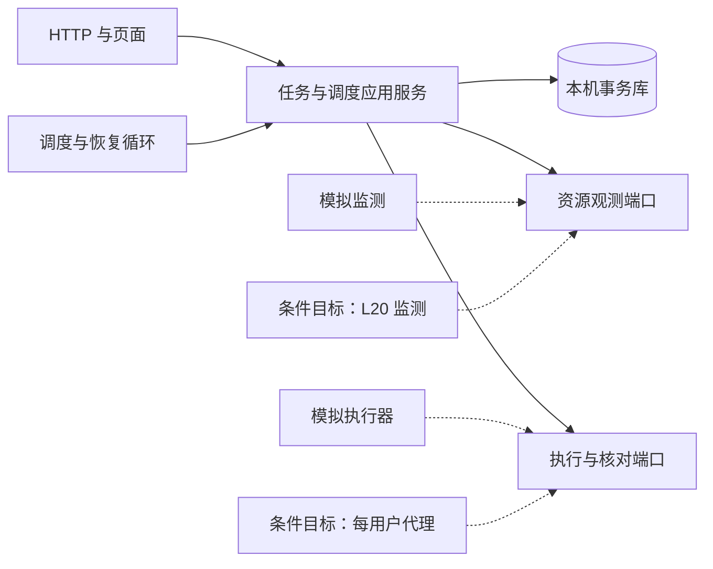

# LabQueue 架构

首版必须交付可复现的双卡模拟闭环，覆盖提交、等待、启动、完成或失败、取消和故障恢复。真实 L20 派发是条件目标，默认关闭。本文供团队及 M2 评审，当前工程仍处于环境搭建阶段，M1/M2 和模拟验收均待完成。[产品简报](product-brief.md) · [PRD](PRD.md) · [项目上下文](../project-context.md) · [决策日志](../../decision-log.md) · [课程要求](../../docs/course-requirements.md)

## 系统边界

采用模块化单体和端口／适配器模式。任务应用服务持有状态迁移规则和事务边界，HTTP、调度循环、监测源和执行器通过其接口协作。资源观测回答「设备现在是否可准入」，执行证据回答「指定的一次执行是否已启动或结束」。两类证据分别建模。

模拟仅绑定 `127.0.0.1`，使用两张稳定标识的虚拟 GPU、合成账号、可控时钟与故障注入。模拟执行器推进持久化的模拟事件，用户提交的任务参数仅作为数据。真实模式使用独立配置、数据目录与凭证，并在启用前核对未决执行和 GPU 保留。真实模式停用后仍可恢复未决状态，且不得产生新启动。

## 架构决策记录（ADR）

### AD-1 · 单主机事务权威

- **Binds（需求）** `FR-02`、`FR-04`、`FR-05`、`FR-07`、`NFR-01`。
- **Prevents（一致性风险）** 状态已变更但租约未同步、两个领取者以同一份旧快照各自成功。
- **Rule（选择）** 模拟首版采用用户确认的单主机 SQLite。任务、入队计数器、当前租约、准入状态、权威模拟时钟和模拟执行事件存于同一数据库。状态迁移由应用服务执行。写入方先以 `BEGIN IMMEDIATE` 取得写事务，再读取并验证前置条件。提交后才发布成功；忙锁或竞争冲突从事务起点重读。已知未提交但事务仍打开时，先回滚再重试；提交结果不明时，停止使用该连接并从新的已提交快照核对，未核实前不重放启动或解除租约。数据库位于本机磁盘，采用 WAL 与 `synchronous=FULL`，部署检查实际生效的设置。事务内只做本机数据操作，外部探测和 RPC 在事务外进行。SQLite 连接和 SQLAlchemy 的事务配置必须验证确实在关键读取前开启写事务。[SQLite 事务](https://www.sqlite.org/lang_transaction.html) · [SQLite WAL](https://sqlite.org/wal.html) · [SQLite 持久性](https://www.sqlite.org/pragma.html#pragma_synchronous) · [SQLAlchemy SQLite 方言](https://docs.sqlalchemy.org/en/21/dialects/sqlite.html#transactions-with-sqlite-and-the-sqlite3-driver)
- **否决方案与理由** 首版使用独立 PostgreSQL 服务。单机双卡的模拟负载可利用 SQLite 的单写者直接串行化关键迁移，维护独立服务会增加部署和验收环境的成本。实测写入竞争或部署拓扑改变时再复核。

### AD-2 · 以持久提交顺序决定全局 FIFO

- **Binds（需求）** `FR-01`、`FR-02`、`FR-03`、`FR-04`、`FR-07`。
- **Prevents（一致性风险）** 时钟回拨改变队位、服务重启后序号倒退、提交重放重复排队、旧响应回退页面状态或重开取消入口。
- **Rule（选择）** 在已取得写权的入队事务内递增全局计数器，并以唯一的 `enqueue_seq` 创建任务。事务提交是入队确认点，即使应答在网络上乱序抵达，队位仍按提交顺序计算。计数器跨重启保留，删任务不回收序号。提交重放以可信所有者和提交幂等键定位原结果，同键异内容拒绝。查询在同一读快照内以仍在排队且序号更小的任务数加一计算本人队位。领取时按 AD-5 检查是否有更早且已核实应回队的任务，再从排队中取最小序号。回队保留原序号；取消后退出队列。确认入队时间以 UTC 保存，用于展示。
- **页面快照版本（D-011）** 模拟首版在同一数据库持久化独立于 `enqueue_seq` 的全局单调快照版本。能改变列表或详情的任务状态、全局队位、等待原因、取消资格或取消请求结果的写入，须在同一事务中推进版本，包括前序任务离队、监测到期及回队。列表、详情及取消结果使用同一版本域；响应版本与所返回事实取自同一已提交快照，不把历史结果当成当前任务状态。同一登录会话的列表和详情共享已见版本下限；切页、刷新或重开时，缺少可比较版本或低于下限的响应不能更新页面或入口。仅含取消结果的回执按请求 ID 核对，不能覆盖、清空或拼成完整快照。任一响应提高下限时，两页低于下限的缓存均只标「上次确认」，不据此恢复取消入口，并重新读取不低于下限的完整快照。相同版本的完整响应可用于不同页面，缺失字段不视为删除。
- **否决方案与理由** 按确认时间排序会受墙钟回拨影响，违背 D-003；按到达顺序或仅凭本人任务的版本更新页面，会漏掉前序任务离队等变化并允许旧响应覆盖。首版沿用全局 FIFO，组归属不改变顺序。

### AD-3 · 领取与 GPU 租约原子提交

- **Binds（需求）** `FR-01`、`FR-02`、`FR-04`、`FR-05`、`NFR-01`。
- **Prevents（一致性风险）** 同卡双租约、同任务双领取、旧执行器改写换卡后的新租约。
- **Rule（选择）** 领取事务重读队首、最新有效准入状态及可用卡，为该任务创建全新的领取 ID，写入 GPU UUID、准入代际与当前租约，同时将任务转为已获准。数据库对当前租约分别强制 GPU UUID 唯一、任务 ID 唯一。当前租约表中的保留持续到按规则显式解除，包含心跳超时和结果待核对的记录。记录领取与解除事件，供恢复和验收使用。涉及已有领取的取消、启动、心跳、待核对、回队、结果和释放都按当前任务状态、领取 ID、GPU UUID 作条件写入，并校验各自所需的身份与证据；旧领取不匹配时不改变任务或当前租约。未知显存可以申请一张完整 GPU 的平台内使用权，已知显存也最多一卡一个平台任务。[SQLite 唯一约束与部分索引](https://www.sqlite.org/partialindex.html#unique_partial_indexes)
- **否决方案与理由** 先更新任务再单独写租约，并靠进程内锁协调。进程崩溃可留下没有租约的已获准任务，第二个进程也看不到该锁。

### AD-4 · 取消与启动共享一个裁决点

- **Binds（需求）** `FR-04`、`FR-05`、`FR-07`、`NFR-01`。
- **Prevents（一致性风险）** 已取消任务被启动、一次回执丢失触发第二次启动。
- **Rule（选择）** 本人取消与模拟启动以同一写事务规则裁决，先成功提交者胜。取消事务核验所有权，并以持久证据区分三种情况：① 已证实启动确认提交，返回已过截止点，不因取消解除租约；回执丢失不改变此判定。② 可证实尚未确认且未启动，且仍排队或仍已获准并持有匹配领取，则同一提交封闭该领取的所有启动路径、置为已取消并解除对应租约；未领取的排队任务没有租约可解除。③ 启动确认事实无法核实，持久记录该领取待核对，不确认取消、不撤销领取或解除原卡保留；若无法提交待核对记录，则按下述持久化异常规则保持准入关闭，不声称已写入。已取消的重放只返回原结果，不再次解除租约。
- **取消请求核对（D-010）** 以经认证的所有者、任务 ID 和取消请求 ID 唯一关联持久结果。有已提交的受理记录但无终局结果才是「处理中」；仅凭超时、查不到记录或无法核实均视为「未知」。每次完成裁决都同提交持久记录原 ID 的终局结果，包括取消成功、已过截止点及仅进入执行待核对时的「本次未取消」。执行待核对不留给原请求日后继续执行；无法确认提交时仍是未知。受理提交本身不抢占取消与启动的裁决。重启后由应用服务按当前持久证据完成已受理未终结的原 ID，不依赖客户端重发。普通刷新只读。仅在本人显式发起的幂等写命令「核对并封存旧取消请求」中，应用服务按 AD-7 校验所有权，在与受理互斥的写事务内复查并持久封存未受理的旧 ID；先提交受理则不封存，返回该请求的已知事实。受理或推进取消前须在同一写事务中检查该 ID 未封存、未终结。终局和封存记录跨重启保留，迟到请求仍可能抵达期间不得删除；此后的迟到请求只读，不改变请求记录、任务、租约、取消事件或快照版本。
- **取消入口** 同一登录会话内，两页共享待核对的取消请求 ID，刷新、切页或重开不丢失；回执只用于匹配的请求，不降级已知终局，也不解除更新 ID 的待核对。仅在 AD-2 的同一完整已提交快照同时证明当前待核对的确切 ID 已终结或封存，且本人任务仍可取消时，恢复取消入口。其余情况只开放状态刷新；未知时可由本人主动发起上述核对命令，不自动重发取消。手动再次取消使用新 ID，仍按本 ADR 裁决；仅当服务端确认取消已提交才显示「已取消」。
- **待核对写入失败** 证据重新可读不足以解除准入关闭。恢复准入前，对受影响的当前领取须核实待核对记录已持久化，未提交则补记；若旧领取已持久封闭则无需补记。重启须先按 AD-5 提交准入代际推进，使重启前未确认的旧领取失效，再按恢复规则处理原租约。
- **模拟启动** 新增启动前，写事务核对当前领取与 GPU UUID、执行方身份、有效租约、未取消、未进入待核对，并按 AD-5 核验权威模拟时钟、观测及领取未失效。须从持久状态证实尚未确认且未启动，不能因没有读到待核对标记就放行。待核对的领取即使证据恢复，也不得清除标记后继续使用原领取启动；由应用服务按 AD-4 取消或按 AD-6 恢复，不由执行方解锁。应用服务在启动事务内同时写入按任务 ID 唯一的启动事件和启动确认，事件提交就是模拟启动。取消或观测过期先提交时，原领取无法创建启动事件。执行方不能凭已失效的未确认领取或不匹配的旧领取发起新确认、启动或改写当前租约；服务端的证据核对与释放仍按 AD-6。匹配当前领取的重放只返回已证实的原结果，证据未知则按 AD-6 核对，不创建新事件。真实执行的边界证明见 AD-8。
- **否决方案与理由** 在领取时关闭取消，或按异步启动回执抵达时间裁决。前者丢失用户确认的撤回窗口，后者可能让任务已经启动又被取消，单凭回执延迟无法判定先后。

### AD-5 · 观测失效关闭准入，旧领取永久失效

- **Binds（需求）** `FR-02`、`FR-03`、`FR-04`、`FR-05`、`FR-09`、`NFR-01`。
- **Prevents（一致性风险）** 过期或不完整观测被当成空闲，监测恢复后旧领取复活。
- **Rule（选择）** 监测源为两张已配置的 GPU UUID 发布完整快照，区分可用、占用和不可确认。由单个发布者写入，拒绝旧发布者代际和乱序样本。有效期从本轮采集开始按同一监测时基计算，到达截止点即过期。任一预期设备漏报、查询失败、过期或外部占用不可确认时，全局阻断新领取与未确认启动；观测转为阻断时同事务推进全局准入代际。单卡确认被外部占用时，同事务持久撤销该卡未确认领取的启动资格。重启先进入无有效观测并推进代际。在接受新样本前也检查上一样本是否已到期；新的有效快照不得清除任何旧领取的失效证据。真实时效值由目标服务器上的采样耗时和可见性验证确定，未配置或未验证时关闭真实准入。
- **模拟时效裁决** 权威模拟时钟只由应用服务在 AD-1 的写事务中单调推进，采集开始和截止点用该时钟，不从墙钟或进程内计时器推断。时钟首次越过或到达当前观测截止点时，同事务标记过期、推进准入代际，但不解除任何租约。时钟推进、监测发布、领取和启动共用提交顺序。最终启动事务取写权后重读权威时钟与最新观测，校验匹配领取的准入代际和该卡持久失效状态；较早的初检不授权。到期先提交则不产生新确认或启动；启动先提交则当时观测有效，后续到期不撤销已提交启动。
- **恢复顺序** 失效或进入待核对的领取继续保留原租约，按 AD-6 核实后才可回队。领取事务直接从同一数据库的任务状态、当前租约、领取失效或待核对状态及启动记录复核较小原序号的回队条件，判断不依赖回队事务先提交或进程内结果。若更早任务已核实应回队但仍未回队，则不得给拟领取的较晚任务发租约，先走回队事务再重取队首。回队保留原序号；若取消先提交，旧恢复请求无效，后续领取不再等待该已取消任务。证据未知不等于已核实应回队，不解除原卡保留，也不改变 AD-4 的取消和启动规则。
- **否决方案与理由** 缓存最后一次空闲结果直到监测恢复，会让旧领取跨失效期启动。仅以提交前最后一次复验作为时效裁决点，也会允许复验后到期的启动提交，不符合 FR-04 的模拟确认边界。

### AD-6 · 回队与释放基于执行证据

- **Binds（需求）** `FR-03`、`FR-04`、`FR-05`、`FR-06`、`FR-07`、`NFR-01`。
- **Prevents（一致性风险）** 结果未知时释放 GPU、重发启动、迟到的恢复结果复活已取消任务。
- **Rule（选择）** 心跳超时只触发核对，保留当前租约并显示「执行状态待核对」。执行证据须对应任务、领取 ID 和 GPU UUID。区分启动确认是否已提交与执行结果是否可核实：已知确认提交但结果未知，仍按 AD-4 拒绝排队取消并保留原卡；确认事实也未知时，不得将读取失败、超时或不完整证据当成未启动。确认仍在运行则继续保留租约，确认该次执行已经结束且无法继续用卡则记录完成或失败并释放，已通过启动确认但能证明最终未创建进程的执行按启动失败结束。OOM 保留原参数，向本人提供诊断。执行结果未知时不解除保留、不新增启动，只继续核对；监测空闲不是该次执行的结束证据。
- **模拟回队** 恢复事务取得写权后重读权威任务状态、当前租约和启动记录。任务仍已获准、当前领取与 GPU UUID 匹配，且领取已失效或已进入待核对时，只有证实未通过启动确认、未启动且未取消，才在同一提交封闭并撤销旧领取、释放原租约并按原入队序号回队；待核对的领取即使观测和准入代际仍有效也执行此规则。取消按 AD-4 独立裁决，取消先提交或当前领取已变更时，旧恢复请求不写入。待核对状态随旧领取结束，不转移到新领取。回队不等于启动许可；重新派发按 AD-2/3/5 取得不同于旧领取的全新领取 ID。
- **否决方案与理由** 心跳超时后释放，或监测恢复显示空闲就自动重发。执行可能已启动但回执丢失，CUDA 上下文也可能尚未建立或暂不可见，会造成同卡重复分配或启动两次。也不恢复待核对的旧领取资格，避免旧启动请求重新获得权限并绕过 FIFO。

### AD-7 · 服务端建立所有权并隔离私有数据

- **Binds（需求）** `FR-01`、`FR-03`、`FR-07`、`FR-08`、`NFR-02`。
- **Prevents（一致性风险）** 伪造用户或群组、已知任务 ID 越权访问、通过日志与异常响应泄露私有字段。
- **Rule（选择）** 模拟采用用户确认的预置合成账号、服务端组映射与认证会话。提交时由服务端写入稳定 `owner_id`，组归属只取可信映射，同组关系不授予任务权限。列表、详情、取消和私有输出统一按会话用户校验所有权，取消在写事务内再次核验。未认证拒绝，已认证访问他人任务与未知任务使用一致的资源不可访问响应。使用浏览器 Cookie 的写操作须校验跨站请求。命令、路径、环境变量、日志存于服务账户私有目录或数据库；按所有权校验后，通过服务端分配的输出引用访问。服务端禁止代读用户提供的绝对或相对文件路径。响应按用途白名单投影，公共看板如提供只用汇总数据。服务日志、监测与证据记录只保留必要标识、事件和分类原因，避免写入任务参数、密钥、私有输出或外部进程细节。后端服务账户与宿主运行环境是可信运维边界。
- **否决方案与理由** 从请求头或表单采信用户／组字段，或让组成员读取全部组任务。客户端字段可伪造，组关系也不足以授予对私有命令和日志的访问权。

### AD-8 · 真实 L20 先验证每用户代理的启动边界

- **Binds（需求）** `FR-04`、`FR-05`、`FR-07`、`FR-08`、`FR-09`。
- **Prevents（一致性风险）** 后端替他人运行命令、离线或重放的许可再次启动、平台干预外部进程。
- **Rule（选择）** 按用户确认，将提交者在其本人 Linux 账号下运行的代理列为条件候选。服务端按可信的登记与核验流程建立应用账号与 Linux UID 的映射，绑定单独的代理凭证，经认证加密通道向代理传输任务。代理只能接收本人任务，并按匹配的领取上报结果和私有输出。启用前核验运行进程的实际 UID。一个目标 GPU UUID 集合只接入一个平台控制面和数据库，所有合作代理服从同一权威。
- **启动边界** 候选协议须证明，凡仍处于可取消排队的状态，都尚未创建任务进程且取消提交可封闭该领取的启动路径。唯一在线裁决与取消互斥，裁决时复验当前领取、最新观测和卡上外部占用，且没有可延后兑现或重复消费的启动许可。代理须持久记录一次性尝试并提供可核实的进程身份与结果。数据库提交与操作系统创建进程之间的故障窗必须纳入验证。失联或启动结果不明时只核对，保留租约，禁止因重放、代理重启或更换代理而再次创建进程。进程核对须绑定启动记录、执行身份及可区分 PID 复用的证据。释放时须确认该执行没有仍可使用 GPU 的子进程。真实进程驱动方案与运行中终止权限需单独评审。
- **否决方案与理由** 共享后端账号直接执行各用户命令，会混用 Linux 权限。用户自行领取后手动启动也不作为首选，因为这会改变派发流程，且平台较难验证手动启动与租约之间的边界。

## 关键状态迁移

「待核对」是执行可见性状态，不等于尚未启动或已取消；其租约仍在当前租约表中。排队用户看到本人的队位与阻塞原因，例如 GPU 被占用、平台租约保留、观测失败、观测过期或外部占用不可确认。所有返回结果以已提交状态为准。

| 操作 | 提交前判定 | 同一提交的结果 |
| --- | --- | --- |
| 入队 | 已认证，幂等键此前未接受 | 分配序号、持久化所有者与任务，进入排队中 |
| 模拟时钟推进并使观测过期 | 取得写权，同一事务内推进权威模拟时钟至当前有效观测截止点或之后 | 观测过期、全局代际推进，阻断新领取与未确认启动；不解除租约，不撤销已确认启动 |
| 恢复有效观测 | 新样本完整、有效且发布顺序合法 | 恢复可准入容量；不复活任何失效领取、不解除原保留、不绕过回队顺序 |
| 领取 | 事务内重读队首及 AD-5 的回队条件，无更早且已核实仍应回队者；两卡观测有效、选中卡可用且无当前租约 | 写入全新领取 ID 和租约，进入已获准；不得复用回队任务的旧领取 ID |
| 启动确认（模拟） | 已证实尚未确认且未启动、未取消、未进入待核对；执行身份、领取与租约匹配，代际和单卡状态均未使领取失效；按事务内权威时钟复核观测有效且选中卡可准入 | 同一提交写入唯一模拟启动事件与启动确认并保留租约；任何准入条件不满足均不新增确认或启动。确认运行结果后展示运行中 |
| 取消排队：证实未启动 | 本人、仍排队或已获准且领取匹配、持久证据证实尚未确认且未启动 | 同事务封闭并撤销已有领取、进入已取消、解除对应租约；重放不再次解除 |
| 取消排队：确认已提交 | 本人、持久证据证实启动确认已提交 | 返回已过截止点；不因取消改写任务或解除租约 |
| 取消排队：确认事实未知 | 本人、仍持有匹配的当前领取、无法核实启动确认是否提交 | 持久记录该领取待核对以阻止新启动；不确认取消、不撤销领取、不解除原卡保留。记录提交失败则按 AD-4 保持准入关闭，证据恢复可读不自动放行 |
| 撤销领取并回队（模拟） | 事务内重查当前领取与 GPU UUID 仍匹配，任务仍已获准，领取已失效或已进入待核对；权威证据证实未通过启动确认、未启动且未取消 | 同一提交封闭并撤销旧领取，释放原租约，按原入队序号回队；不恢复旧启动资格。证据仍未知则保留原卡；取消先提交或领取已变更则迟到恢复不写入 |
| 执行结果待核对 | 当前领取和 GPU UUID 匹配、尚未终结，经核对证据仍不足；超时或回执丢失只触发检查 | 持久记录原因并保留租约，不降格已证实的启动确认。旧领取不改写当前状态；接收回执或主动查询均校验身份与领取 |
| 确认终态 | 当前执行已确认完成或失败，且不会再使用该卡 | 记录终态和释放事件，解除对应租约 |

## 部署与验收边界

- **环境基线** 沿用仓库 Python 3.12 与 `uv.lock`。当前锁定 FastAPI 0.143.0、Jinja2 3.1.6、Uvicorn 0.54.0、SQLAlchemy 2.1.4。起草时本机运行时为 Python 3.12.15 和 SQLite 3.53.1。待部署目标另行核对版本、文件权限与持久化配置。[依赖锁文件](../../uv.lock)
- **恢复与运维** 服务重启后读回序号、租约、启动记录和未决状态，接受新观测后按上述状态机恢复可派发容量。监测和执行核对出现异常时仍允许本人查询以及符合条件的排队取消。持久化不可用时暂停写入与派发。备份从一致快照获取。真实模式从备份恢复、丢失数据库或更换代理时，封闭旧启动路径并核对可能仍在运行的作业后才恢复派发。
- **真实 L20 开关** 需有架构评审和服务器证据，包括独立核验账号与 UID 的绑定、代理凭证与控制通道、GPU UUID、两卡外部占用可见性与观测有效期、启动与取消先后、回执丢失和进程归属、重启恢复及运行中终止的权限边界。还须检查普通提交者无法读取控制面的数据库、凭证和输出目录，并核对宿主上进程参数及环境的可见范围。进程查询可能受权限和上下文类型限制，须在目标主机普通权限下验证。外部进程仍可能在复验与启动之间抢占 GPU，平台租约只约束合作任务。对冲突记录原因并核对本平台执行，不终止平台外进程。前置条件满足后才安排使用合成任务的受控 L20 验收。[NVIDIA NVML 设备查询](https://docs.nvidia.com/deploy/nvml-api/latest/api/group__nvmlDeviceQueries.html)

| PRD 验收 | 待采集证据 | ADR |
| --- | --- | --- |
| GATE-01，AC-01/02/03/13 | 两卡忙到单卡释放、同时间与回拨、重启后序号与队位、完成与 OOM 后租约统计 | AD-1、AD-2、AD-3、AD-6 |
| GATE-02，AC-04/05/14/15 | 三种监测失效；过期先提交时零新增领取、启动确认和启动，启动先提交时保留唯一已提交事件；在旧租约仍保留和新租约已建立两阶段重放，核对租约及变更记录不变；B 实际进入领取裁决仍不得越过已核实应回队的 A，取消先提交则拒绝迟到回队 | AD-1、AD-2、AD-3、AD-4、AD-5、AD-6 |
| GATE-03，AC-06/07/08 与 NFR-01 | 同卡争用、取消与启动两种提交顺序、领取后中断、取消已提交但无响应。持久化模拟启动事件后丢弃回执，并暂时屏蔽核对接口读回；此时注入心跳超时和空闲观测，从独立验收记录核对租约解除、同卡新增派发和再次启动均为 0 | AD-1、AD-3、AD-4、AD-6 |
| GATE-04，AC-09/10/11 与 NFR-02 | 本人取消正向对照、同组及异组越权、匿名及伪造身份、已知任务 ID、私有字段标记和状态差异 | AD-4、AD-7 |
| 条件目标，AC-12 | 真实派发保持关闭，待目标服务器上的身份、可见性和故障验证；启用后才采集受控任务启动与终态记录。监测异常时新增真实派发为 0；该项不阻塞模拟首版 | AD-5、AD-6、AD-7、AD-8 |

结合 AC-07/08/10 补充 B1 模拟取证：让裁决方无法核实权威启动确认事实，而非仅丢弃回执。此时并发请求本人取消、延迟首次启动或重放启动、分配原卡，断言取消确认、保留解除、原卡新增派发和新启动均为 0。恢复证据后，若确认已提交，取消仍返回已过截止点；若可证实未确认、未启动且领取可封闭，验证本人取消与解除租约同提交。

**B1-R1（D-007，待采集模拟证据）**：按 AC-08 隔离执行证据故障，保持原领取的观测和准入代际有效，验证待核对期间保留原卡、恢复证据后按 AD-6 同提交封闭旧领取、释放原租约并按原序号回队；重新领取使用新 ID，旧请求不能启动或写入新租约。取消先提交的对照按 AC-10 核对不回队，并按 AC-15 的领取顺序检查核实后、回队前没有任务越过 A。

验收报告应明确标注模拟或真实条件，记录场景、预期和实际结果。首版延期组权重、同卡共享、显存预测与自动重试。运行期采样峰值只作为带时间、采样间隔与配置指纹的观察，配置变化后须重新积累证据。队列性能指标及实时恢复参数待有代表性的负载和环境数据后另行确定。
