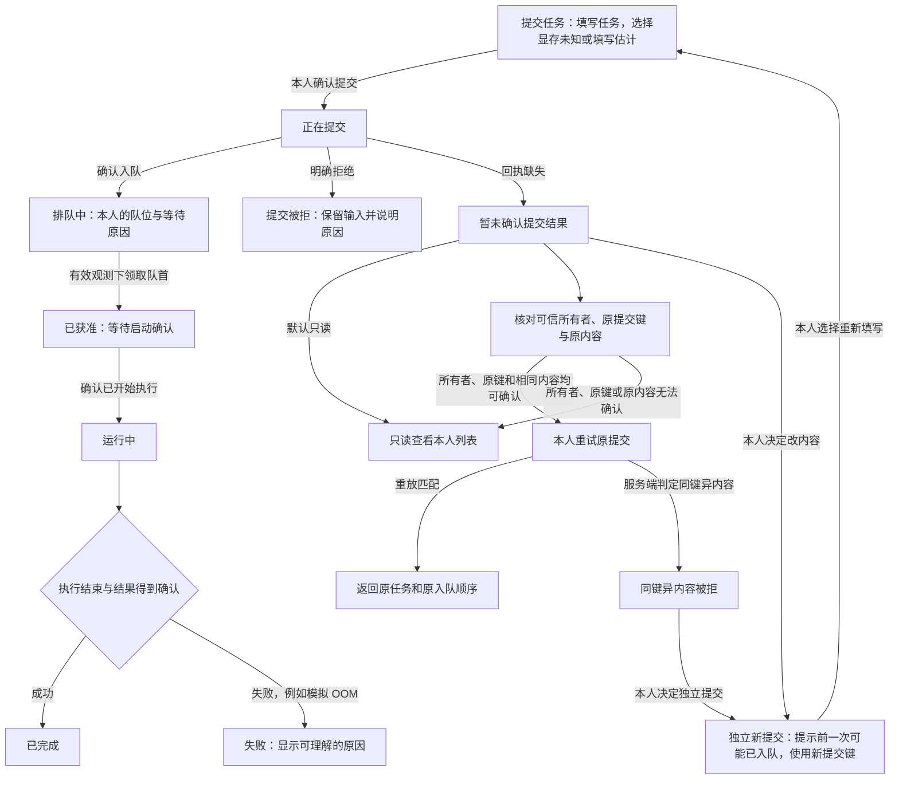
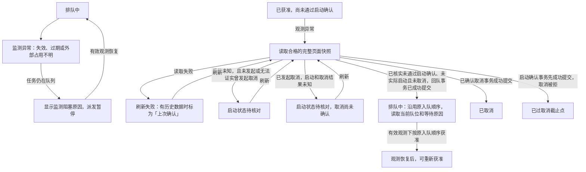
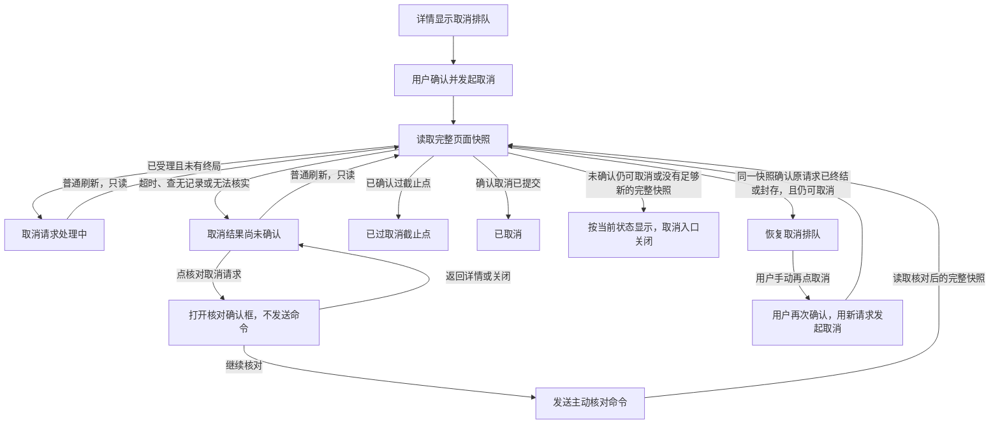
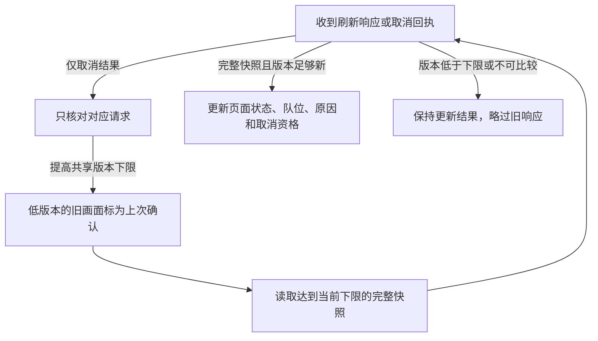

# LabQueue M2 低保真线框

**待人工评审草稿 · 2026-11-19。** 三页框图采用 [DESIGN.md 的候选 A](DESIGN.md#brand--style--品牌与风格) 的信息层级。按钮以方括号标记。人物、字段、任务和时刻均为合成示例。行为和待确认项见 [EXPERIENCE.md](EXPERIENCE.md)。

**2026-11-21 补订，待人工复核。** 按 Vamsinger 的复审和 `main@74e41b9` 已记录的 D-010、D-011 同步取消核对与页面更新规则。D-007 已在同一基线核实。[Vamsinger 的复审](https://github.com/108Rocket/LabQueue/pull/2#issuecomment-7034143807) · [main 决策日志](https://github.com/108Rocket/LabQueue/blob/74e41b95b422e886a143320ed500b014c6d58b86/decision-log.md) · [架构](https://github.com/108Rocket/LabQueue/blob/74e41b95b422e886a143320ed500b014c6d58b86/_bmad-output/planning-artifacts/architecture.md) · [Story](https://github.com/108Rocket/LabQueue/blob/74e41b95b422e886a143320ed500b014c6d58b86/_bmad-output/planning-artifacts/epics.md)

**Q5、Q6 补订 · AI 代理取舍，待人工评审。** 服务端依据来自 `main@74e41b9`，登录提示、拒绝页文案和重试入口为本稿候选。[AD-2 与 AD-7](https://github.com/108Rocket/LabQueue/blob/74e41b95b422e886a143320ed500b014c6d58b86/_bmad-output/planning-artifacts/architecture.md) · [Story 1.1 与 1.3](https://github.com/108Rocket/LabQueue/blob/74e41b95b422e886a143320ed500b014c6d58b86/_bmad-output/planning-artifacts/epics.md)

**AI 代理决定。** 初稿的取消与回队规则来自 cxx 本轮转达。本次按 Vamsinger 的 Q1–Q4 人工意见修订，待人工复核。[评审意见](https://github.com/108Rocket/LabQueue/pull/2#issuecomment-7009392929)

## 三页框图

### 1. 提交任务

```text
+------------------------------------------------------------------------------+
| LabQueue     [提交任务] 当前     [我的任务]                                  |
+------------------------------------------------------------------------------+
| 提交任务                                                                     |
|                                                                              |
| 任务名（示例字段）  [ 形状检查 A                                ]            |
| 执行命令（示例字段）                                                         |
| [ 示例命令                                                      ]            |
|                                                                              |
| 显存估计           (x) 未知      ( ) 填写估计                                |
| 选「未知」仍可提交，排队申请一张 GPU 的平台内使用权。                        |
|                                                                              |
| [提交任务]                                                                   |
+------------------------------------------------------------------------------+
```

| 分支 | 表单区反馈 |
| --- | --- |
| 填写估计 | 展开 `显存估计 [ 数值 ] [单位待定]`。字段和单位待确认，见 Q6。 |
| 已发送，等待确认 | `[正在提交 · 暂不可重复提交]`。 |
| 确认入队 | `已入队 · 形状检查 A · 显存未知`，提供 `[查看我的任务]` 和 `[打开任务详情]`。后续页面读取当前状态。 |
| 明确拒绝 | 在相应字段或提交反馈区说明原因，保留已填内容。 |
| 首次成功但回执缺失，或暂无法确认结果 | `暂未确认提交结果`，默认只读 `[查看我的任务]`。 |
| 同一可信所有者、同一原提交键和完全相同内容均可确认 | 候选显示 `[重试原提交]`，由本人主动选择；返回原任务时可 `[打开任务详情]`。 |
| 无法确认仍为同一可信所有者，或无法确认原提交键或原内容 | 保留未确认反馈和 `[查看我的任务]`，省略重试入口。 |
| 同键异内容被拒，或用户决定修改内容 | 独立 `[新建提交]`，提示 `前一次提交仍可能已入队`。修改后由本人再次确认，使用新提交键。 |
| 匿名或会话失效 | 候选显示 `请登录后继续`，表单和任务数据不可见。 |

监测异常时仍可提交，确认入队后可在列表查看监测阻塞原因。重试合同见 AD-2 / Story 1.1；字段、显存单位待确认，无需跨页缓存私有命令。FR-01 至 FR-04 / AC-01、AC-02、AC-04、AC-13。

### 2. 我的任务

```text
+------------------------------------------------------------------------------+
| LabQueue     [提交任务]     [我的任务] 当前                                  |
+------------------------------------------------------------------------------+
| 我的任务                                                [刷新状态]           |
| 时间以 UTC+08:00 显示                                                        |
|                                                                              |
| 任务             状态      队位     当前说明             确认入队时间        |
+------------------------------------------------------------------------------+
| [形状检查 A]     排队中    第 1 位  GPU 正被占用         11-19 09:41         |
| 显存：未知                                                                   |
| [对照样例]       已完成    —        执行已结束           11-18 15:20         |
+------------------------------------------------------------------------------+
```

林妍看见 A 排第 1 位，显存仍为未知。另一个研究组的周宁只看见自己的 B。两卡都忙时，B 显示「第 2 位 · GPU 正被占用」。A 获准后，B 改为「第 1 位」，等待原因随已确认事实更新。已获准、运行和终态条目不显示当前队位。确认入队时间附时区，队位读取系统确认的入队顺序。FR-02、FR-03、FR-08 / AC-01、AC-02、AC-11、AC-13。

**同一任务核对后的列表行替换**

| 系统可确认的信息 | 状态列 | 队位列 | 当前说明列 |
| --- | --- | --- | --- |
| 已确认受理，尚无终局 | 按已确认任务状态显示 | 按当前快照 | `取消请求处理中` |
| 已发起取消，超时或查无记录 | 按已确认任务状态显示 | 按当前快照 | `取消结果尚未确认`，可打开详情核对 |
| 旧取消请求已封存或有终局，且同一完整快照确认仍可取消 | 按已确认任务状态显示 | 按当前快照 | `可在详情重新发起取消` |
| 已确认取消事务成功提交 | `已取消` | `—` | `任务已退出队列` |
| 启动确认事务先成功提交，取消被拒 | 按已确认的任务状态显示 | `—` | `已过取消截止点` |
| 从未发起取消，启动状态待核对 | `启动状态待核对` | `—` | `打开详情查看` |
| 已发起取消且取消结果未确认，启动状态待核对 | `启动状态待核对，取消尚未确认`（可换行） | `—` | `打开详情查看` |
| 已核实未通过启动确认、未实际启动且未取消，回队事务已成功提交 | `排队中` | `第 N 位` | `已按原排队顺序返回队列`，并显示当前等待原因。 |

回队沿用原入队顺序。两页显示服务端读取的当前队位与等待原因。FR-02 至 FR-05、FR-07 / AC-07、AC-08、AC-10、AC-14、AC-15。

| 列表分支 | 该用户可见的行内反馈 |
| --- | --- |
| 监测失效 | `排队中 · 第 1 位 · GPU 监测暂不可用，派发已暂停`。 |
| 数据过期 | `排队中 · 第 1 位 · GPU 观测数据已过期，正在等待有效观测`。 |
| 外部占用不明 | `排队中 · 第 1 位 · 暂无法确认 GPU 的平台外占用情况，派发已暂停`。 |
| 已确认启动，结束结果仍待核对 | `执行结果待核对`，可打开该任务详情。其他提交者只看见自己的队位及通用阻塞原因，例如 `暂时没有已确认可派发的 GPU`。 |
| 本次刷新失败 | 显示 `暂时无法刷新任务状态`。已有本人状态、队位和等待原因标为 `上次确认`，队位按历史值展示。 |
| 空列表 | `还没有任务`，提供 `[提交任务]`。从「暂未确认提交结果」进入时，若暂未见原任务，继续保留未确认提示。 |
| 回执丢失但服务端已入队 | 打开本人列表便可看到自己的原任务。只读查看不触发提交。 |
| 匿名或会话失效 | 候选显示 `请登录后继续`，列表无任务内容。 |

列表与详情共用已见的服务端快照版本下限。较旧或无可比版本的响应不更新页面。低版本画面标 `上次确认`。仅含取消结果的回执等待完整快照更新，可参照 [两页乱序走查](EXPERIENCE.md#列表与详情的乱序走查)。异常示例中的队位以服务端可确认的当前值为准。FR-03 至 FR-05 / AC-04、AC-05、AC-08、AC-14、AC-15。

### 3. 任务详情

```text
+------------------------------------------------------------------------------+
| LabQueue     [提交任务]     [我的任务]                                       |
+------------------------------------------------------------------------------+
| [返回我的任务]                                         [刷新状态]            |
|                                                                              |
| 任务详情  /  形状检查 A                                                      |
|                                                                              |
| 已获准                                                                       |
| 已取得一张 GPU 的平台内使用权，正在等待启动确认。                            |
| [取消排队]                                                                   |
+------------------------------------------------------------------------------+
| 任务配置                                                                     |
| 显存估计    未知                                                             |
| 确认入队    11-19 09:41（UTC+08:00）                                         |
| 执行命令    示例命令（本人可见）                                             |
+------------------------------------------------------------------------------+
```

| 详情状态 | 状态区替换内容 |
| --- | --- |
| 排队中 | `排队中 · 第 1 位`，下方显示等待原因及可用的 `[取消排队]`。在监测异常时说明派发暂停。 |
| 已获准，监测异常 | 单独显示 GPU 监测提示，例如 `GPU 观测数据已过期，派发已暂停。` 下方状态区按启动和取消的核对结果更新。 |
| 运行中 | `运行中 · 已确认开始执行`，取消排队入口已撤下。 |
| 已完成 | `已完成 · 执行已结束`。 |
| 失败 | `任务失败：GPU 显存不足。原任务参数已保留。` 这是模拟 OOM 分支。 |
| 已确认受理，尚无终局 | `取消请求处理中`，保留 `[刷新状态]`。 |
| 已发起取消，超时或查无记录 | `取消结果尚未确认`，保留 `[刷新状态]`、`[核对取消请求]`。核对入口打开确认框，取消入口关闭。 |
| 旧取消请求已封存或有终局，且同一完整快照确认仍可取消 | 恢复 `[取消排队]`。用户再次确认后才发起新请求。 |
| 已确认取消事务成功提交 | `已取消 · 任务已退出队列`。撤下取消入口。 |
| 从未发起取消，启动状态待核对 | `启动状态待核对`。保留 `[刷新状态]`，取消资格确认后才提供 `[取消排队]`。 |
| 已发起取消且取消结果未确认，启动状态待核对 | `启动状态待核对，取消尚未确认`。普通刷新只读。在取消结果未知时可点 `[核对取消请求]` 打开确认框。 |
| 已核实未通过启动确认、未实际启动且未取消，回队事务已成功提交 | `排队中 · 第 N 位`。显示 `已按原排队顺序返回队列` 及当前等待原因。取消入口按已确认的资格显示。 |
| 本次刷新失败 | `暂时无法刷新任务状态`。已有本人状态、队位和等待原因标为 `上次确认`。 |
| 匿名或会话失效 | 候选显示 `请登录后继续`，详情与操作不可见。 |
| 已登录但无权访问，或任务不存在 | 同一候选反馈 `无法查看此任务` 和 `[返回我的任务]`。两类访问拒绝回复均不含他人的任务、私有字段或存在性线索。AD-7 / Story 1.3，AC-11、NFR-02。 |

**取消确认及返回详情后的反馈**

```text
+------------------------------------------------------------------------------+
| 取消排队                                                                     |
| 任务：形状检查 A                                                             |
| 任务在启动确认前可以取消。                                                   |
|                                                                              |
| [返回详情]（初始焦点）             [确认取消]                                |
+------------------------------------------------------------------------------+
```

| 确认之后 | 详情反馈 |
| --- | --- |
| 取消请求处理中 | 显示 `取消请求处理中`，状态区只提供 `[刷新状态]`。 |
| 已确认取消事务成功提交 | 两页状态更新为 `已取消`。 |
| 启动确认事务先成功提交，取消被拒 | 两页反馈 `已过取消截止点`，任务按已确认的执行状态展示。详情撤下取消入口。 |
| 超时、查无记录或无法核实 | 显示 `取消结果尚未确认`。`[刷新状态]` 只读。点 `[核对取消请求]` 打开确认框，确认后才主动核对。 |
| 主动核对确认旧请求已停止处理，或已读到原请求终局 | 同一份合格的完整快照确认仍可取消后，恢复 `[取消排队]`。手动再次确认使用新请求 ID。 |

启动确认与取消确认以服务端事务先成功提交的一方为准。点击顺序与回执到达顺序只反映交互过程。

FR-03、FR-04、FR-06 至 FR-08 / AC-03、AC-07、AC-09 至 AC-11、AC-14。

**已发起取消，启动和取消都待核对的详情示例**

```text
+------------------------------------------------------------------------------+
| 任务详情  /  形状检查 A                                [刷新状态]            |
|                                                                              |
| 启动状态待核对，取消尚未确认                                                 |
| 上次确认：已获准                                                             |
|                                                                              |
| GPU 监测：观测数据已过期，派发已暂停。                                       |
|                                                                              |
| [核对取消请求]                                                               |
| 先查看核对说明，再决定是否继续。                                             |
+------------------------------------------------------------------------------+
```

从未发起取消时，状态区只写「启动状态待核对」。长提示须有已发起取消的证据。监测异常提示可独立更新，观测恢复后仍按已提交的任务状态决定是否结束核对。见 [Q1 至 Q4](EXPERIENCE.md#与-cxx-待确认)。FR-02 至 FR-05、FR-07 / AC-07、AC-08、AC-14、AC-15，NFR-01。

**核对取消请求确认框 · AI 代理取舍，待人工评审**

```text
+------------------------------------------------------------------------------+
| 核对取消请求                                                    [关闭]       |
|                                                                              |
| 如果上一次取消请求尚未受理，继续核对会阻止它之后生效。                       |
| 已经受理的请求会继续处理。                                                   |
|                                                                              |
| [返回详情]                                      [继续核对]                   |
+------------------------------------------------------------------------------+
```

打开确认框、点「返回详情」、点「关闭」或按 Escape 均只改变界面，不发送核对命令。点击「继续核对」后才由服务端核对。若原请求已先受理且无终局，显示「取消请求处理中」，保留「刷新状态」，取消入口继续关闭。已有终局时按已确认的结果与完整快照展示。D-010 / AD-4 / Story 3.1–3.3。

## 流程图

### 提交、排队和执行结果



### 监测异常与回队



在回队事务提交之前，维持已确认状态。若取消确认先成功提交，晚到的旧回队结果不会覆盖「已取消」。

### 取消与启动竞争



只有「继续核对」才发送主动核对命令。若受理已先提交且无终局，原请求继续处理，显示「取消请求处理中」且取消入口关闭；已有终局时按已确认结果与完整快照展示。若未受理的旧请求已被持久封存，详情可提示「上一次取消请求已停止处理」。恢复入口后，在用户点击新取消前，迟到并重放的旧请求不得改变任务、租约或取消记录。仅含取消结果的回执须等待完整快照刷新页面。FR-05、FR-07 / AC-07、AC-10、NFR-01，AD-4 / Story 3.1–3.3。

### 两页的页面更新



列表和详情在同一会话内共享已见版本下限。切页、重开和刷新使用同一规则，低于下限的旧画面不给取消资格。D-011 / AD-2 / Story 1.2、3.2、4.2。
