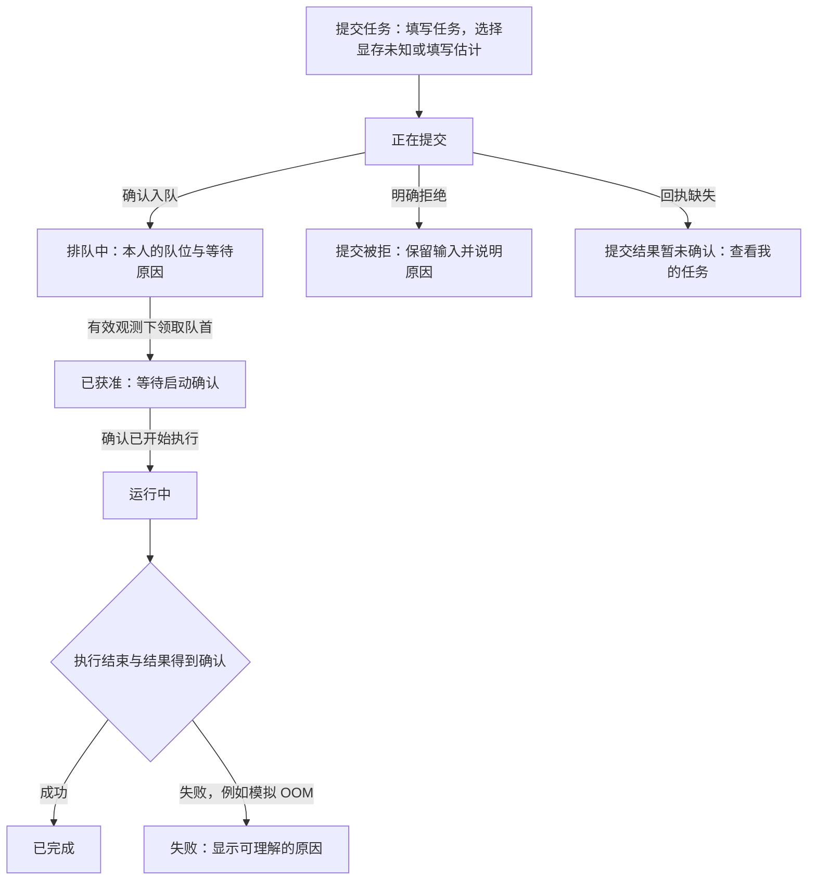
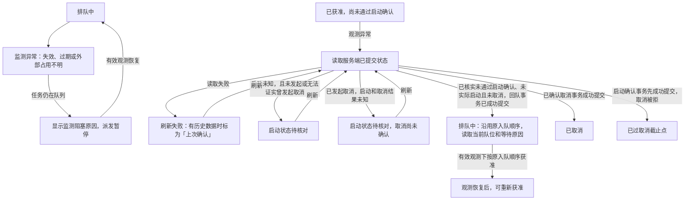
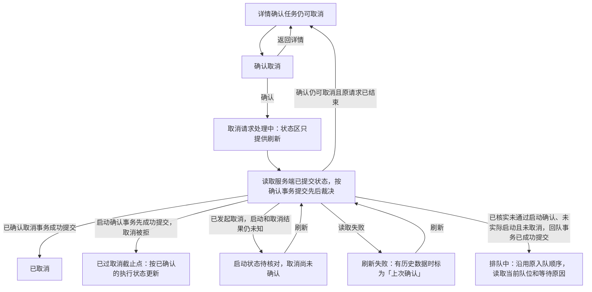

# LabQueue M2 低保真线框

**待人工评审草稿 · 2026-11-19。** 三页框图采用 [DESIGN.md 的候选 A](DESIGN.md#brand--style--品牌与风格) 的信息层级。按钮以方括号标记。人物、字段、任务和时刻均为合成示例。行为和待确认项见 [EXPERIENCE.md](EXPERIENCE.md)。

**AI 代理决定。** 初稿的取消与回队规则来自 cxx 本轮转达。本次按 Vamsinger 的 Q1–Q4 人工意见修订，待人工复核。[评审意见](https://github.com/108Rocket/LabQueue/pull/2#issuecomment-7009392929)

## 三页框图

### 1. 提交任务

```text
+------------------------------------------------------------------------------+
| LabQueue     [提交任务] 当前     [我的任务]                                  |
+------------------------------------------------------------------------------+
| 提交任务                                                                     |
|                                                                              |
| 任务名（示例字段）  [ 形状检查 A                                ]            |
| 执行命令（示例字段）                                                         |
| [ 示例命令                                                      ]            |
|                                                                              |
| 显存估计           (x) 未知      ( ) 填写估计                                |
| 选「未知」仍可提交，排队申请一张 GPU 的平台内使用权。                        |
|                                                                              |
| [提交任务]                                                                   |
+------------------------------------------------------------------------------+
```

| 分支 | 表单区反馈 |
| --- | --- |
| 填写估计 | 展开 `显存估计 [ 数值 ] GiB`。单位是草图候选，见 Q6。 |
| 已发送，等待确认 | `[正在提交 · 暂不可重复提交]`。 |
| 确认入队 | `已入队 · 形状检查 A · 显存未知`，提供 `[查看我的任务]` 和 `[打开任务详情]`。后续页面读取当前状态。 |
| 明确拒绝 | 在相应字段或提交反馈区说明原因，保留已填内容。 |
| 无法确认结果 | `暂未确认提交结果。` 保留输入并提供 `[查看我的任务]`。再次提交时机见 Q6。 |

监测异常时仍可提交，确认入队后可在列表查看监测阻塞原因。FR-01 至 FR-04 / AC-01、AC-02、AC-04、AC-13。

### 2. 我的任务

```text
+------------------------------------------------------------------------------+
| LabQueue     [提交任务]     [我的任务] 当前                                  |
+------------------------------------------------------------------------------+
| 我的任务                                                [刷新状态]           |
| 时间以 UTC+08:00 显示                                                        |
|                                                                              |
| 任务             状态      队位     当前说明             确认入队时间        |
+------------------------------------------------------------------------------+
| [形状检查 A]     排队中    第 1 位  GPU 正被占用         11-19 09:41         |
| 显存：未知                                                                   |
| [对照样例]       已完成    —        执行已结束           11-18 15:20         |
+------------------------------------------------------------------------------+
```

林妍看见 A 排第 1 位，显存仍为未知。另一个研究组的周宁只看见自己的 B。两卡都忙时，B 显示「第 2 位 · GPU 正被占用」。A 获准后，B 改为「第 1 位」，等待原因随已确认事实更新。已获准、运行和终态条目不显示当前队位。确认入队时间附时区，队位读取系统确认的入队顺序。FR-02、FR-03、FR-08 / AC-01、AC-02、AC-11、AC-13。

**同一任务核对后的列表行替换**

| 系统可确认的信息 | 状态列 | 队位列 | 当前说明列 |
| --- | --- | --- | --- |
| 已确认取消事务成功提交 | `已取消` | `—` | `任务已退出队列` |
| 启动确认事务先成功提交，取消被拒 | 按已确认的任务状态显示 | `—` | `已过取消截止点` |
| 从未发起取消，启动状态待核对 | `启动状态待核对` | `—` | `打开详情查看` |
| 已发起取消且取消结果未确认，启动状态待核对 | `启动状态待核对，取消尚未确认`（可换行） | `—` | `打开详情查看` |
| 已核实未通过启动确认、未实际启动且未取消，回队事务已成功提交 | `排队中` | `第 N 位` | `已按原排队顺序返回队列`，并显示当前等待原因。 |

回队沿用原入队顺序。两页显示服务端读取的当前队位与等待原因。FR-02 至 FR-05、FR-07 / AC-07、AC-08、AC-10、AC-14、AC-15。

| 列表分支 | 该用户可见的行内反馈 |
| --- | --- |
| 监测失效 | `排队中 · 第 1 位 · GPU 监测暂不可用，派发已暂停`。 |
| 数据过期 | `排队中 · 第 1 位 · GPU 观测数据已过期，正在等待有效观测`。 |
| 外部占用不明 | `排队中 · 第 1 位 · 暂无法确认 GPU 的平台外占用情况，派发已暂停`。 |
| 已确认启动，结束结果仍待核对 | `执行结果待核对`，可打开该任务详情。其他提交者只看见自己的队位及通用阻塞原因，例如 `暂时没有已确认可派发的 GPU`。 |
| 本次刷新失败 | 显示 `暂时无法刷新任务状态`。已有本人状态、队位和等待原因标为 `上次确认`，队位按历史值展示。 |
| 空列表 | `还没有任务`，提供 `[提交任务]`。 |

列表与详情刷新时重读服务端已提交状态。较旧的响应晚到时，保留已展示的更新状态。异常示例中的队位以服务端可确认的当前值为准。FR-03 至 FR-05 / AC-04、AC-05、AC-08、AC-14、AC-15。

### 3. 任务详情

```text
+------------------------------------------------------------------------------+
| LabQueue     [提交任务]     [我的任务]                                       |
+------------------------------------------------------------------------------+
| [返回我的任务]                                         [刷新状态]            |
|                                                                              |
| 任务详情  /  形状检查 A                                                      |
|                                                                              |
| 已获准                                                                       |
| 已取得一张 GPU 的平台内使用权，正在等待启动确认。                            |
| [取消排队]                                                                   |
+------------------------------------------------------------------------------+
| 任务配置                                                                     |
| 显存估计    未知                                                             |
| 确认入队    11-19 09:41（UTC+08:00）                                         |
| 执行命令    示例命令（本人可见）                                             |
+------------------------------------------------------------------------------+
```

| 详情状态 | 状态区替换内容 |
| --- | --- |
| 排队中 | `排队中 · 第 1 位`，下方显示等待原因及可用的 `[取消排队]`。在监测异常时说明派发暂停。 |
| 已获准，监测异常 | 单独显示 GPU 监测提示，例如 `GPU 观测数据已过期，派发已暂停。` 下方状态区按启动和取消的核对结果更新。 |
| 运行中 | `运行中 · 已确认开始执行`，取消排队入口已撤下。 |
| 已完成 | `已完成 · 执行已结束`。 |
| 失败 | `任务失败：GPU 显存不足。原任务参数已保留。` 这是模拟 OOM 分支。 |
| 已确认取消事务成功提交 | `已取消 · 任务已退出队列`。撤下取消入口。 |
| 从未发起取消，启动状态待核对 | `启动状态待核对`。保留 `[刷新状态]`，取消资格确认后才提供 `[取消排队]`。 |
| 已发起取消且取消结果未确认，启动状态待核对 | `启动状态待核对，取消尚未确认`。状态区只提供 `[刷新状态]`。服务端确认仍可取消且原请求已结束后，恢复 `[取消排队]`。 |
| 已核实未通过启动确认、未实际启动且未取消，回队事务已成功提交 | `排队中 · 第 N 位`。显示 `已按原排队顺序返回队列` 及当前等待原因。取消入口按已确认的资格显示。 |
| 本次刷新失败 | `暂时无法刷新任务状态`。已有本人状态、队位和等待原因标为 `上次确认`。 |
| 无权访问或任务不存在 | `无法查看此任务` 和 `[返回我的任务]`。页面只显示通用导航与反馈。 |

**取消确认及返回详情后的反馈**

```text
+------------------------------------------------------------------------------+
| 取消排队                                                                     |
| 任务：形状检查 A                                                             |
| 任务在启动确认前可以取消。                                                   |
|                                                                              |
| [返回详情]（初始焦点）             [确认取消]                                |
+------------------------------------------------------------------------------+
```

| 确认之后 | 详情反馈 |
| --- | --- |
| 取消请求处理中 | 显示 `取消请求处理中`，状态区只提供 `[刷新状态]`。 |
| 已确认取消事务成功提交 | 两页状态更新为 `已取消`。 |
| 启动确认事务先成功提交，取消被拒 | 两页反馈 `已过取消截止点`，任务按已确认的执行状态展示。详情撤下取消入口。 |
| 回执缺失，启动与取消结果仍待核对 | 已发起取消，保留 `启动状态待核对，取消尚未确认`。详情状态区只提供 `[刷新状态]`。 |
| 服务端确认仍可取消且原请求已结束 | 恢复 `[取消排队]`。 |

启动确认与取消确认以服务端事务先成功提交的一方为准。点击顺序与回执到达顺序只反映交互过程。

FR-03、FR-04、FR-06 至 FR-08 / AC-03、AC-07、AC-09 至 AC-11、AC-14。

**已发起取消，启动和取消都待核对的详情示例**

```text
+------------------------------------------------------------------------------+
| 任务详情  /  形状检查 A                                [刷新状态]            |
|                                                                              |
| 启动状态待核对，取消尚未确认                                                 |
| 上次确认：已获准                                                             |
|                                                                              |
| GPU 监测：观测数据已过期，派发已暂停。                                       |
|                                                                              |
| 确认仍可取消且原请求已结束后，恢复取消入口。                                 |
+------------------------------------------------------------------------------+
```

从未发起取消时，状态区只写「启动状态待核对」。长提示须有已发起取消的证据。监测异常提示可独立更新，观测恢复后仍按已提交的任务状态决定是否结束核对。见 [Q1 至 Q4](EXPERIENCE.md#与-cxx-待确认)。FR-02 至 FR-05、FR-07 / AC-07、AC-08、AC-14、AC-15，NFR-01。

## 流程图

### 提交、排队和执行结果



### 监测异常与回队



在回队事务提交之前，维持已确认状态。若取消确认先成功提交，晚到的旧回队结果不会覆盖「已取消」。

### 取消与启动竞争



仅在服务端已确认仍可取消且无进行中请求时恢复详情的取消入口。若已显示更新的状态，忽略晚到的旧读取结果。
